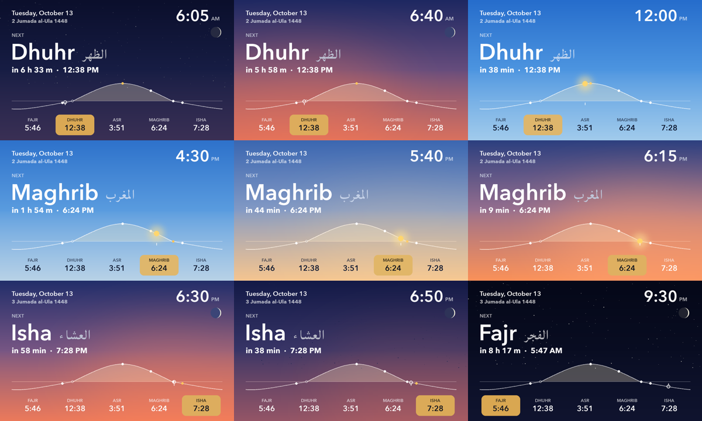

# skyclock

A prayer-times clock drawn over the real sky, for a $50 ESP32 touch panel on the wall. Live at **https://pray.sifxtreme.com**.



- **Sky:** the colour follows the sun's actual altitude: day blue, golden hour, sunset, blue hour, night. A warm glow sits on the sun's side of the horizon. At night there are stars and the moon in its exact phase.
- **Now and next:** the current prayer is the main item. It shows the time left and a bar that drains, turns amber at 20 min and red at 5 min (e.g. Fajr before sunrise, Asr before Maghrib). Between sunrise and Dhuhr, when no fard prayer is due, the next prayer leads.
- **24-hour curve:** the sun's path over the day with the five prayers on it and a marker for now.
- **Hijri date:** Umm al-Qura, rolling over at Maghrib.

## Prayer times

The settings match ISOC (Islamic Society of Orange County, Garden Grove, CA), taken from its public timetable settings (adhan.js `azanParams`):

| Setting | Value |
|---|---|
| Fajr / Isha angle | 15° / 15° |
| Asr | standard (Shafi) |
| Adjustments | Dhuhr +1 min, Maghrib +3 min |
| Location | the masjid's coordinates |
| Rounding | seconds dropped, except **Maghrib rounds up**, so it is never shown early |

On every day of 2026 from Feb 2 to Dec 31, the result is within 1 minute of ISOC's published timetable. Change `ISOC_LAT/ISOC_LNG` and `ADJUST_MIN` in `skyclock.py` for your own masjid.

The sun and moon math is self-contained (no API calls). It follows the PrayTimes.org formulation, with Asr's shadow length as in adhan.js and the moon phase from Meeus, *Astronomical Algorithms* ch. 48. Checked against `ephem` through 2026, the moon phase was within 0.24% of the disc.

## Run the server

```bash
pip install -r requirements.txt
python3 skyclock.py render out.png [--at 2026-10-13T18:05]   # one image
python3 skyclock.py serve 8790 127.0.0.1                     # GET / , /sky.png , /healthz
```

It uses the macOS system fonts Avenir Next and Baghdad (for the Arabic). On another OS, point `font()` and `ARABIC` at fonts you have.

`/sky.png` renders a fresh 800x480 PNG on every request, in about 50 ms. `/` is a page that reloads it every 30 s.

## The panel

[`esphome/`](esphome/) has the ESPHome config for the **Waveshare ESP32-S3-Touch-LCD-7**, and [`esphome/FLASHING.md`](esphome/FLASHING.md) covers the first USB flash (including the gotchas) and later flashes over Wi-Fi. The panel just fetches `image_url` every 30 s; all the drawing happens on the server.

## How pray.sifxtreme.com runs

The server runs on a Mac at home as a launchd service (`launchd/com.asif.skyclock.plist`), exposed through a Cloudflare Tunnel (`launchd/com.asif.pray-tunnel.plist`). The plists are examples; adjust paths, user and tunnel ID for yours.

## License

MIT
